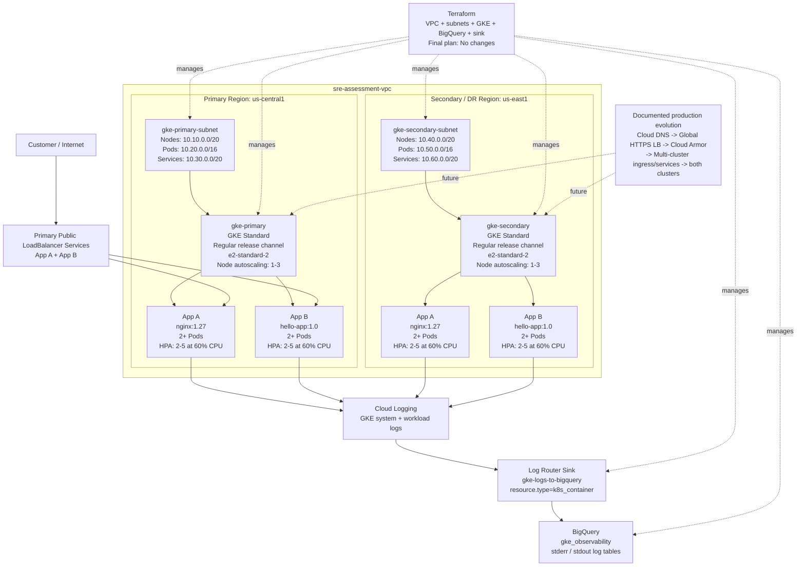

# GKE SRE Assessment Architecture

## Legend

- Solid lines show implemented traffic, workload, or logging relationships.
- Dashed Terraform lines show infrastructure represented and managed through Terraform.
- The production-evolution block is architectural intent, not claimed as implemented assessment infrastructure.
