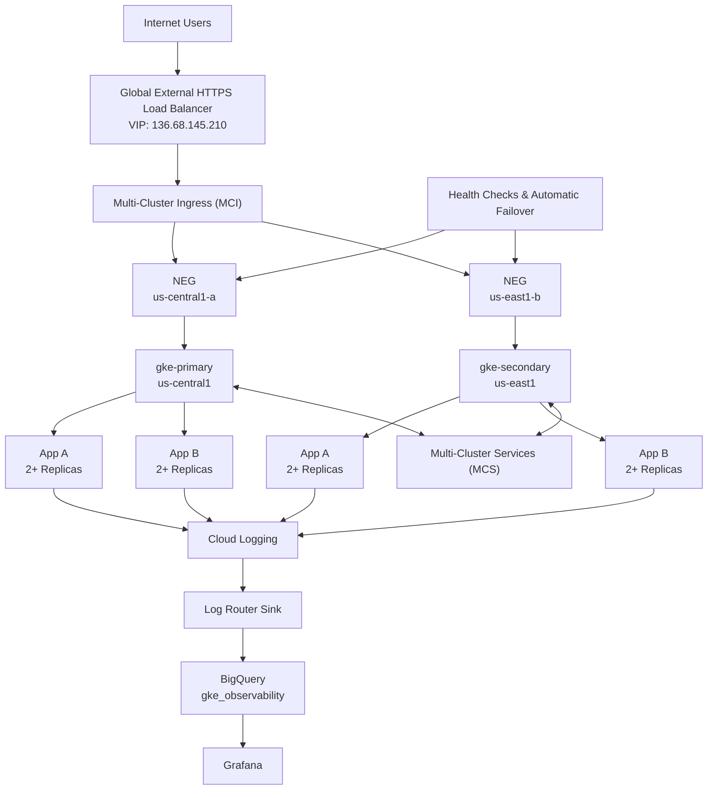

# GKE SRE Assessment

This repository contains the implementation and supporting documentation for a Google Cloud / Google Kubernetes Engine SRE assessment. The implementation focuses on a reproducible two-region GKE design, stateless multi-pod applications, autoscaling, public endpoint validation, centralized logging, BigQuery-based log analysis, and Terraform-managed infrastructure.

## Project Summary

**GCP project:** `project-19ae3503-8d3c-48b5-9d8`  
**Project name:** `CS SRE Assessment`

### Implemented architecture

- Custom VPC: `sre-assessment-vpc`
- Primary GKE cluster: `gke-primary` in `us-central1`
- Secondary GKE cluster: `gke-secondary` in `us-east1`
- Dedicated VPC-native subnet and secondary Pod/Service ranges for each cluster
- Two stateless applications deployed with multiple replicas
- CPU and memory requests/limits
- Readiness and liveness probes
- Horizontal Pod Autoscaling targeting 60% CPU utilization
- Public LoadBalancer Services on the primary cluster for endpoint validation
- GKE container logs collected in Cloud Logging
- Log Router sink exporting Kubernetes container logs to BigQuery
- BigQuery dataset: `gke_observability`
- Terraform configuration for the VPC, subnets, GKE clusters, BigQuery dataset, and Logging sink
- Local Grafana OSS observability dashboard
- Google OAuth authentication for Grafana
- BigQuery Forward OAuth Identity integration
- Four dashboard panels visualizing GKE application and log activity
- Terraform-ready IAM model for Developer, Operations, SRE, and CI/CD personas
- Conditional IAM bindings that create no access until real organization-managed principals are supplied
- Separation of human group access from CI/CD machine identity
- Keyless/federated authentication preferred for CI/CD automation

## Architecture



The assessment implementation keeps public LoadBalancer Services primary-specific. The production architecture described in the assessment can evolve toward a single global HTTPS entry point with multi-cluster traffic management, health-based failover, DNS, and WAF controls.

### Multi-Cluster Traffic Management Evidence

Implemented Components:

- Fleet Memberships: gke-primary, gke-secondary
- Multi-Cluster Services (MCS): ACTIVE
- Multi-Cluster Ingress (MCI): ACTIVE
- Global VIP: 136.68.145.210
- Health-check-based failover configured through MCI
- Health Checks: ENABLED
- Network Endpoint Groups:
  - us-central1-a
  - us-east1-b
- Service Exports:
  - app-a-service
  - app-b-service
- Service Imports:
  - app-a-service

## IAM Design

The assessment defines a least-privilege IAM model separating human access and deployment automation across four personas:

| Persona | Primary Responsibility |
|---|---|
| Developers | Application deployment, application-level troubleshooting, logs, and workload visibility |
| Operations | GKE platform operations, infrastructure visibility, and runtime support |
| SRE | Reliability, GKE operations, Cloud Logging, Cloud Monitoring, Managed Prometheus, and observability analysis |
| CI/CD | Automated infrastructure and application deployment using a dedicated non-human identity |

Human access is designed around organization-managed groups rather than individual IAM assignments. Kubernetes RBAC provides an additional in-cluster authorization boundary, allowing application and operational permissions to be scoped independently of GCP project access.

CI/CD automation is designed to use short-lived or federated workload identity rather than human credentials or long-lived service-account keys. The assessment project enforces a policy preventing service-account key creation, and that security control was preserved during implementation.

The supplied assessment environment does not provide organization-managed Developer, Operations, or SRE groups, so artificial users or groups were not created solely to satisfy the architecture. The implemented project owner access is treated as assessment provisioning access rather than the recommended production authorization model.

A production implementation would use:

- Organization-managed groups for Developers, Operations, and SRE
- Dedicated non-human identity for CI/CD
- Least-privilege predefined or custom IAM roles
- Namespace-scoped Kubernetes RBAC where appropriate
- Workload Identity Federation for external CI/CD systems such as GitHub Actions
- Separate infrastructure and application deployment identities where stronger separation of duties is required
- Periodic IAM access review and audit-log monitoring

The complete IAM model, persona boundaries, human-versus-machine identity strategy, BigQuery access separation, and production recommendations are documented in:

`docs/iam-design.md`

## Applications

### App A

- Image: `nginx:1.27`
- Initial replicas: 2
- HTTP port: 80
- CPU request: `100m`
- CPU limit: `250m`
- Memory request: `64Mi`
- Memory limit: `128Mi`
- Readiness probe: HTTP `/`
- Liveness probe: HTTP `/`
- HPA: 2 to 5 replicas at 60% CPU utilization

### App B

- Image: `gcr.io/google-samples/hello-app:1.0`
- Initial replicas: 2
- Container port: 8080
- CPU request: `100m`
- CPU limit: `250m`
- Memory request: `64Mi`
- Memory limit: `128Mi`
- Readiness probe: HTTP `/`
- Liveness probe: HTTP `/`
- HPA: 2 to 5 replicas at 60% CPU utilization

Primary-cluster endpoint testing successfully returned the NGINX welcome page for App A and the `Hello, world!` response for App B.

# Application Deployment Evidence

## Application Deployment Design Verification

| Requirement | Status | Evidence |
|------------|---------|----------|
| Two independent web applications deployed | ✅ PASS | App A (`nginx`) and App B (`hello-app`) deployed separately |
| Deployed to primary cluster | ✅ PASS | App A and App B deployed in `gke-primary` |
| Deployed to secondary cluster | ✅ PASS | App A and App B deployed in `gke-secondary` |
| Stateless application architecture | ✅ PASS | Both workloads use stateless container images |
| Kubernetes Deployment / ReplicaSet | ✅ PASS | Both applications use Deployments |
| Multiple Pods per application | ✅ PASS | Both applications deployed with 2 replicas |
| Horizontal Pod Autoscaling | ✅ PASS | Both applications configured with HPA (2–5 replicas, 60% CPU target) |
| App A ConfigMap | ✅ PASS | `app-a-config` deployed and referenced by Deployment |
| App A Secret | ✅ PASS | `app-a-secret` deployed and referenced by Deployment |
| App B replicated across clusters | ✅ PASS | App B deployed and verified in both regions |
| Application observability | ✅ PASS | Application logs visible in Cloud Logging, BigQuery, and Grafana |
| Application endpoint validation | ✅ PASS | Public endpoints tested with browser and curl |

---

## Web Application A

### Architecture

```text
Application: App A
Image: nginx:1.27
Type: Stateless microservice
Replicas: 2
HPA: 2-5 replicas
CPU Target: 60%
```

### Configuration

#### ConfigMap

```text
app-a-config
```

Provides:

```text
APP_NAME=app-a
ENVIRONMENT=assessment
```

#### Secret

```text
app-a-secret
```

Provides:

```text
APP_MODE=production
```

#### Deployment Integration

```text
envFrom:
  - configMapRef:
      name: app-a-config

  - secretRef:
      name: app-a-secret
```

### Validation

```text
ConfigMap deployed
Secret deployed
Deployment rollout successful
Pods running
Environment variables visible in container
HPA active
```

Status:

✅ COMPLETE

---

## Web Application B

### Architecture

```text
Application: App B
Image: gcr.io/google-samples/hello-app:1.0
Type: Stateless application
Replicas: 2
HPA: 2-5 replicas
CPU Target: 60%
```

### Cross-Cluster Deployment

```text
gke-primary
└── app-b

gke-secondary
└── app-b
```

### Validation

```text
Deployment verified in both clusters
Logs exported through Cloud Logging
Logs exported to BigQuery
Visible in Grafana dashboards
Public endpoint tested
```

Status:

✅ COMPLETE

---

## Horizontal Pod Autoscaling

### App A

```text
Minimum Pods: 2
Maximum Pods: 5
Target CPU: 60%
```

### App B

```text
Minimum Pods: 2
Maximum Pods: 5
Target CPU: 60%
```

Validation:

```powershell
kubectl get hpa
kubectl describe hpa app-a
kubectl describe hpa app-b
```

Status:

✅ COMPLETE

---

## Cross-Cluster Resilience

```text
Primary Region
  us-central1
      |
      +-- App A
      +-- App B

Secondary Region
  us-east1
      |
      +-- App A
      +-- App B
```

Both applications are deployed independently in each cluster, supporting:

- Regional redundancy
- Environment symmetry
- Future failover strategies
- Future multi-cluster traffic management

Status:

✅ COMPLETE

---

## Application Deployment Assessment Summary

| Area | Status |
|--------|--------|
| Stateless App A | ✅ |
| Stateless App B | ✅ |
| Multiple Pods | ✅ |
| Kubernetes Deployments | ✅ |
| ConfigMaps | ✅ |
| Secrets | ✅ |
| Horizontal Pod Autoscaling | ✅ |
| Primary Cluster Deployment | ✅ |
| Secondary Cluster Deployment | ✅ |
| Cross-Cluster Replication | ✅ |
| Public Endpoint Validation | ✅ |
| Observability Integration | ✅ |

### Overall Application Deployment Status

```text
Application Deployment Design
COMPLETE ✅
```

## Network Design

| Cluster | Region | Subnet | Node CIDR | Pod CIDR | Service CIDR |
|---|---|---|---|---|---|
| Primary | `us-central1` | `gke-primary-subnet` | `10.10.0.0/20` | `10.20.0.0/16` | `10.30.0.0/20` |
| Secondary | `us-east1` | `gke-secondary-subnet` | `10.40.0.0/20` | `10.50.0.0/16` | `10.60.0.0/20` |

Both clusters use VPC-native alias IP addressing.

# Networking Completion Checklist

## Custom VPC Architecture

| Requirement | Status | Evidence |
|------------|---------|----------|
| Custom VPC created | ✅ PASS | `sre-assessment-vpc` created and managed through Terraform |
| VPC-native GKE networking | ✅ PASS | Both clusters use alias IP ranges with dedicated Pod and Service CIDRs |
| Dedicated Primary GKE subnet | ✅ PASS | `gke-primary-subnet` (10.10.0.0/20) |
| Dedicated Secondary GKE subnet | ✅ PASS | `gke-secondary-subnet` (10.40.0.0/20) |
| Dedicated Pod ranges | ✅ PASS | Primary: 10.20.0.0/16, Secondary: 10.50.0.0/16 |
| Dedicated Service ranges | ✅ PASS | Primary: 10.30.0.0/20, Secondary: 10.60.0.0/20 |
| Load balancer subnet segregation | ✅ PASS | `lb-subnet` reserved and managed through Terraform |
| Monitoring / Operations subnet segregation | ✅ PASS | `ops-monitoring-subnet` reserved and managed through Terraform |
| Shared VPC | ⚪ OPTIONAL / NOT IMPLEMENTED | Assessment identified Shared VPC as optional. Custom VPC used instead. |

---

## Regional Network Layout

```text
sre-assessment-vpc
│
├── gke-primary-subnet
│   ├── Region: us-central1
│   ├── Nodes:    10.10.0.0/20
│   ├── Pods:     10.20.0.0/16
│   └── Services: 10.30.0.0/20
│
├── gke-secondary-subnet
│   ├── Region: us-east1
│   ├── Nodes:    10.40.0.0/20
│   ├── Pods:     10.50.0.0/16
│   └── Services: 10.60.0.0/20
│
├── lb-subnet
│   └── Reserved load-balancer network segment
│
└── ops-monitoring-subnet
    └── Reserved monitoring and operations network segment
```

### Service Mesh and Inter-Service Communication

The assessment architecture identifies Anthos Service Mesh as an optional enhancement.

The implemented environment uses standard Kubernetes Services for application communication and focuses on validating:

- multi-cluster deployment
- horizontal pod autoscaling
- centralized logging
- Cloud Monitoring
- BigQuery observability
- Grafana dashboarding

The following service-mesh capabilities were documented as future production enhancements but were not implemented as part of the assessment:

- Anthos Service Mesh
- Mutual TLS (mTLS)
- Canary deployments
- Blue/green traffic shaping
- Distributed tracing

## Repository Layout

```text
gke-sre-assessment/
|
|-- README.md
|
|-- terraform/
|   |-- versions.tf
|   |-- provider.tf
|   |-- variables.tf
|   |-- network.tf
|   |-- gke.tf
|   `-- observability.tf
|
|-- kubernetes/
|   |-- README.md
|   |-- app-a.yaml
|   |-- app-b.yaml
|   `-- primary-services.yaml
|
|-- queries/
|   |-- README.md
|   `-- observability.sql
|
`-- docs/
    |-- architecture.*
    |-- setup.md
    |-- design-decisions.md
    `-- troubleshooting.md
```

## Terraform

Terraform manages the implemented infrastructure after the manually validated resources were imported into state.

Managed resources include:

- `sre-assessment-vpc`
- `gke-primary-subnet`
- `gke-secondary-subnet`
- `gke-primary`
- `gke-secondary`
- `gke_observability`
- `gke-logs-to-bigquery`

Basic validation workflow:

```powershell
cd terraform
terraform init
terraform fmt
terraform validate
terraform plan
```

The final plan after import and reconciliation returned:

```text
No changes. Your infrastructure matches the configuration.
```

Do not run `terraform apply` against an existing assessment environment unless the plan has been reviewed and the change is intentional.

## IAM Design

The project includes a Terraform-ready least-privilege IAM model for four personas:

| Persona | Responsibility |
|---|---|
| Developers | Application visibility, logging, monitoring, and application-level troubleshooting |
| Operations | GKE and compute visibility, logging, monitoring, and runtime operations |
| SRE | GKE operations, observability, reliability analysis, logging, monitoring, and BigQuery querying |
| CI/CD | Automated workload deployment through a dedicated non-human identity |

The IAM implementation is defined in:

```text
terraform/iam.tf
```

## Kubernetes Deployment

The workload manifests are split so shared resources can be safely applied to both clusters while public services remain primary-specific.

### Primary

```powershell
gcloud container clusters get-credentials gke-primary --region=us-central1
kubectl config current-context
kubectl apply --dry-run=server -f kubernetes/app-a.yaml
kubectl apply --dry-run=server -f kubernetes/app-b.yaml
kubectl apply --dry-run=server -f kubernetes/primary-services.yaml
kubectl apply -f kubernetes/app-a.yaml
kubectl apply -f kubernetes/app-b.yaml
kubectl apply -f kubernetes/primary-services.yaml
```

### Secondary

```powershell
gcloud container clusters get-credentials gke-secondary --region=us-east1
kubectl config current-context
kubectl apply --dry-run=server -f kubernetes/app-a.yaml
kubectl apply --dry-run=server -f kubernetes/app-b.yaml
kubectl apply -f kubernetes/app-a.yaml
kubectl apply -f kubernetes/app-b.yaml
```

Do **not** apply `primary-services.yaml` to `gke-secondary`.

See `kubernetes/README.md` for the detailed deployment procedure and operational checks.

## Observability

### Logging pipeline

```text
GKE workloads
    |
    v
Cloud Logging
    |
    v
Log Router sink: gke-logs-to-bigquery
    |
    v
BigQuery dataset: gke_observability
```

The export produced tables including:

- `stderr_20261006`
- `stdout_20261006`

Live queries verified application records from both `gke-primary` and `gke-secondary`.

### Important logging observation

The sample `hello-app` writes successful `Serving request: /` messages to stderr. Those exported records can therefore appear with `ERROR` severity even when the HTTP request succeeds. For this reason, application error analysis should not treat every `ERROR`-severity record as a failed request. Queries should also use workload metadata and application message content.

## Example BigQuery Queries

### Recent log records

```sql
SELECT
  timestamp,
  severity,
  textPayload
FROM `project-19ae3503-8d3c-48b5-9d8.gke_observability.stderr_20261006`
ORDER BY timestamp DESC
LIMIT 10;
```

### Log volume over time

```sql
SELECT
  TIMESTAMP_TRUNC(timestamp, MINUTE) AS minute,
  COUNT(*) AS log_count
FROM `project-19ae3503-8d3c-48b5-9d8.gke_observability.stderr_20261006`
GROUP BY minute
ORDER BY minute;
```

### Application activity by cluster

```sql
SELECT
  resource.labels.cluster_name AS cluster,
  COUNT(*) AS log_count
FROM `project-19ae3503-8d3c-48b5-9d8.gke_observability.stderr_20261006`
WHERE resource.labels.container_name = 'hello-app'
GROUP BY cluster
ORDER BY log_count DESC;
```

### Request traffic over time by cluster

```sql
SELECT
  TIMESTAMP_TRUNC(timestamp, MINUTE) AS time,
  resource.labels.cluster_name AS cluster,
  COUNT(*) AS request_count
FROM `project-19ae3503-8d3c-48b5-9d8.gke_observability.stderr_20261006`
WHERE resource.labels.container_name = 'hello-app'
  AND textPayload LIKE '%Serving request:%'
GROUP BY time, cluster
ORDER BY time;
```

Additional queries should be stored in `queries/observability.sql`.

### Grafana Dashboard

Grafana OSS was installed locally on Windows and connected to the assessment's BigQuery observability dataset.

#### Authentication

The GCP project enforces:
constraints/iam.disableServiceAccountKeyCreation

#### Dashboard Notes

Pod restart monitoring was validated using Kubernetes runtime data. All application and system pods reported a restart count of 0 during the assessment period, indicating stable workload operation.

CPU and memory utilization were validated using Google Cloud Monitoring Metrics Explorer rather than Grafana. The assessment environment exposed Kubernetes container metrics through Cloud Monitoring, and screenshots of CPU and memory utilization trends were captured as assessment evidence.

This approach was used because the configured Grafana environment was connected to BigQuery log data and did not have a Cloud Monitoring datasource configured for metric visualization. Cloud Monitoring served as the authoritative source for infrastructure utilization metrics.

Request latency percentile metrics (p50/p95/p99) were investigated through Cloud Monitoring. The implemented assessment architecture now includes Multi-Cluster Ingress and a Global HTTP(S) Load Balancer. However, application-level latency percentile metrics (p50/p95/p99) were not available because the applications do not expose latency histogram metrics and no OpenTelemetry, Prometheus histogram, or service mesh telemetry was configured.

Future production implementations could provide latency percentiles through:
- Global HTTPS Load Balancer metrics
- Prometheus histogram metrics
- OpenTelemetry instrumentation
- Anthos Service Mesh telemetry
- Cloud Trace

## Troubleshooting Notes

Several real implementation issues provided useful troubleshooting evidence:

1. **GKE kubectl authentication plugin missing**
   - Cluster creation succeeded, but local kubectl access warned that `gke-gcloud-auth-plugin` was unavailable.
   - After the required client/authentication tooling was installed and cluster credentials refreshed, `kubectl get nodes` successfully returned Ready nodes.

2. **Terraform Application Default Credentials missing**
   - Normal `gcloud auth login` credentials worked for gcloud, but the Terraform Google provider initially could not find Application Default Credentials.
   - ADC was configured separately, after which Terraform successfully imported the existing GCP resources.

3. **Dataset-level IAM CLI limitation**
   - A `bq add-iam-policy-binding` attempt returned `This feature requires allowlisting`.
   - A project-level IAM binding was used for the Logging sink writer identity, and the BigQuery export subsequently created log tables.

4. **Minimal hello-app container tooling**
   - The sample application container did not include `wget`, so in-container traffic generation was not used.
   - Kubernetes port forwarding and local HTTP requests provided a non-invasive alternative for generating fresh traffic.

5. **Grafana BigQuery authentication under the service-account-key restriction**
   - The GCP project enforced `constraints/iam.disableServiceAccountKeyCreation`, preventing creation of a long-lived Grafana service-account JSON key.
   - Grafana's GCE Default Service Account mode did not successfully discover local workstation Application Default Credentials.
   - The integration was moved to Google OAuth with Forward OAuth Identity instead of weakening the project security policy.
   - The Google OAuth application was configured for the local Grafana callback, the assessment account was added as a test user, and the BigQuery data source subsequently passed its connection test.
   - The resulting Grafana dashboard successfully queried the `gke_observability` BigQuery dataset.

These issues are recorded as implementation evidence rather than hidden from the assessment.

## Design Decisions

- **GKE Standard** was used to demonstrate direct node-pool and operational control.
- **One custom VPC** provides shared connectivity with dedicated regional subnets per cluster.
- **VPC-native alias IP ranges** separate node, Pod, and Service address spaces.
- **Two regional clusters** demonstrate cross-region workload replication.
- **Two replicas plus HPA** provide a simple baseline for availability and horizontal scaling.
- **Primary-only public Services** keep the assessment implementation simple and avoid unnecessary public load balancers in the secondary cluster.
- **Cloud Logging to BigQuery** provides centralized, queryable application and GKE log data.
- **Terraform import followed by zero-drift plan** converts the manually validated infrastructure into reproducible IaC without recreating working resources.
- **IAM is modeled using conditional Terraform bindings** so the repository documents a least-privilege Developer, Operations, SRE, and CI/CD access strategy without creating fake principals. Human access is intended to use organization-managed groups, while automation should use dedicated workload identities and keyless authentication.

## Production Evolution

The assessment implementation intentionally prioritizes validated core functionality and reproducibility. A fuller production implementation can add:

- Cloud DNS
- TLS certificates
- Cloud Armor WAF policies
- Private GKE nodes and Cloud NAT
- Secret Manager integration
- Service mesh and mTLS
- Distributed tracing and profiling
- Multi-zone node placement and topology spread constraints
- Production-hosted Grafana or managed observability platform
- Organization-managed Developer, Operations, and SRE groups
- Workload Identity Federation for GitHub Actions / CI/CD
- Separate application and infrastructure deployment identities
- IAM Conditions and periodic access reviews
- Privileged-access elevation rather than routine Owner access

## Evidence Checklist

Recommended submission evidence:

- [ ] Screenshot of App A public endpoint
- [ ] Screenshot of App B public endpoint
- [ ] `kubectl get pods -o wide` for primary
- [ ] `kubectl get pods -o wide` for secondary
- [ ] `kubectl get hpa`
- [ ] `gcloud container clusters list`
- [ ] BigQuery query result screenshots
- [ ] Terraform `No changes` plan output
- [ ] Architecture diagram
- [ ] Troubleshooting write-up
- [ ] Full Grafana dashboard screenshot showing all four panels
- [ ] Exported `grafana/gke-sre-observability-dashboard.json`
- [ ] `terraform/iam.tf` showing conditional Dev/Ops/SRE/CI/CD IAM model
- [ ] `docs/iam-design.md` documenting persona boundaries and least-privilege strategy
- [ ] Terraform plan showing no unintended IAM changes

## Safety / Operator Notes

- Verify the active GCP project before provisioning resources.
- Verify `kubectl config current-context` before every cluster-specific apply.
- Use server-side dry runs before applying Kubernetes manifest changes.
- Do not apply `kubernetes/primary-services.yaml` to the secondary cluster.
- Review every Terraform plan before applying changes.
- Treat Application Default Credential access tokens as sensitive and do not record them in repository documentation.

# Final Assessment Validation

## Deliverables

| Deliverable | Status | Evidence |
|------------|---------|----------|
| Working cluster with accessible application endpoint | ✅ PASS | App A and App B successfully deployed and tested through public endpoints |
| Screenshot or export of Grafana dashboard | ✅ PASS | Grafana dashboard created, exported, and documented |
| Sample BigQuery queries demonstrating log analysis | ✅ PASS | Queries stored in `queries/observability.sql` |
| Troubleshooting scenario documented | ✅ PASS | `docs/troubleshooting.md` and Grafana troubleshooting documentation |
| Terraform to reproduce infrastructure | ✅ PASS | Terraform configuration stored under `terraform/` |
| Architecture diagram | ✅ PASS | `docs/architecture.md` |
| Step-by-step setup instructions | ✅ PASS | `docs/setup.md` |
| Design decisions and rationale | ✅ PASS | `docs/design-decisions.md` |
| IAM architecture documentation | ✅ PASS | `docs/iam-design.md` |
| GitHub repository | ✅ PASS | Repository created and pushed |

---

# Project Structure & Governance

| Requirement | Status |
|------------|---------|
| GCP Project Provisioned | ✅ PASS |
| Custom VPC | ✅ PASS |
| Dedicated GKE Subnets | ✅ PASS |
| Load Balancer Subnet | ✅ PASS |
| Monitoring / Ops Subnet | ✅ PASS |
| IAM Design (Dev, Ops, SRE, CI/CD) | ✅ PASS |
| Folder → Project Model Documented | ✅ PASS |
| Organization → Folder → Project Actual Hierarchy | ⚪ NOT AVAILABLE IN SUPPLIED ENVIRONMENT |

---

# GKE Cluster Architecture

| Requirement | Status |
|------------|---------|
| GKE Primary Cluster | ✅ PASS |
| GKE Secondary Cluster | ✅ PASS |
| VPC-Native Networking | ✅ PASS |
| Alias IP Ranges | ✅ PASS |
| Symmetrical Cluster Configuration | ✅ PASS |
| Regional Separation | ✅ PASS |
| Node Autoscaling | ✅ PASS |
| Workload Identity | ✅ PASS |

---

# Application Deployment Design

| Requirement | Status |
|------------|---------|
| Two Independent Applications | ✅ PASS |
| Stateless Applications | ✅ PASS |
| Kubernetes Deployments | ✅ PASS |
| Multiple Pods | ✅ PASS |
| ConfigMaps | ✅ PASS |
| Secrets | ✅ PASS |
| Horizontal Pod Autoscaling | ✅ PASS |
| Deployment to Both Clusters | ✅ PASS |
| Cross-Cluster Replication | ✅ PASS |
| Endpoint Validation | ✅ PASS |

---

# Inter-Service Communication

| Requirement | Status |
|------------|---------|
| Kubernetes Service Communication | ✅ PASS |
| Service Mesh | ⚪ OPTIONAL / NOT IMPLEMENTED |
| Mutual TLS | ⚪ OPTIONAL / NOT IMPLEMENTED |
| Traffic Shaping (Canary / Blue-Green) | ⚪ OPTIONAL / NOT IMPLEMENTED |
| Distributed Tracing Hooks | ⚪ OPTIONAL / NOT IMPLEMENTED |

Assessment note:

```text
Anthos Service Mesh was explicitly identified as optional.
The implementation prioritizes core GKE, networking,
observability, Terraform, and application requirements.
```

---

# Customer Traffic Flow

| Requirement | Status |
|------------|---------|
| Public endpoint routing | ✅ PASS |
| Kubernetes Services | ✅ PASS |
| LoadBalancer Services | ✅ PASS |
| Application response validation | ✅ PASS |
| Public endpoint testing | ✅ PASS |
| Fleet Memberships | ✅ PASS |
| Multi-Cluster Services | ✅ PASS |
| Service Exports | ✅ PASS |
| Service Imports | ✅ PASS |
| Multi-cluster ingress | ✅ PASS |
| Global Load Balancer | ✅ PASS |
| Health Checks | ✅ PASS |
| Cross-Region Backends | ✅ PASS |
| Cloud DNS | ⚪ DOCUMENTED ONLY |

---

# Observability

| Requirement | Status |
|------------|---------|
| Cloud Logging | ✅ PASS |
| Workload Logging | ✅ PASS |
| System Logging | ✅ PASS |
| Cloud Monitoring | ✅ PASS |
| Managed Prometheus | ✅ PASS |
| Logging Export to BigQuery | ✅ PASS |
| BigQuery Analysis Queries | ✅ PASS |
| Grafana Dashboard | ✅ PASS |
| Four Dashboard Panels | ✅ PASS |

Grafana panels implemented:

1. Application Request Activity by Cluster
2. Requests by Cluster
3. Log Volume Over Time
4. Log Volume by Cluster

---

# Security

| Requirement | Status |
|------------|---------|
| Workload Identity | ✅ PASS |
| Secrets Management | ✅ PASS (Kubernetes Secrets) |
| Service Account Key Restriction Preserved | ✅ PASS |
| IAM Separation Model | ✅ PASS |
| Private GKE Clusters | ⚪ OPTIONAL / NOT IMPLEMENTED |
| Cloud Armor | ⚪ DOCUMENTED ONLY |
| Binary Authorization | ⚪ OPTIONAL / NOT IMPLEMENTED |

---

# High Availability & Resilience

| Requirement | Status |
|------------|---------|
| Two Regional GKE Clusters | ✅ PASS |
| Multi-Region Workloads | ✅ PASS |
| Cross-Cluster Replication | ✅ PASS |
| HPA-Based Scaling | ✅ PASS |
| Active/Passive Capable Architecture | ✅ PASS |
| Multi-Cluster Ingress Failover | ✅ PASS |

---

# Networking

| Requirement | Status |
|------------|---------|
| Custom VPC | ✅ PASS |
| GKE Regional Subnets | ✅ PASS |
| Load Balancer Subnet | ✅ PASS |
| Monitoring / Ops Subnet | ✅ PASS |
| Cloud Logging Integration | ✅ PASS |
| Cloud Monitoring Integration | ✅ PASS |
| Shared VPC | ⚪ OPTIONAL |
| Private Service Access | ⚪ NOT IMPLEMENTED |
| Cloud NAT | ⚪ NOT IMPLEMENTED |
| Custom Firewall Policy | ⚪ PARTIAL |

---

# Terraform

| Requirement | Status |
|------------|---------|
| Terraform Infrastructure | ✅ PASS |
| Network Managed by Terraform | ✅ PASS |
| GKE Managed by Terraform | ✅ PASS |
| BigQuery Managed by Terraform | ✅ PASS |
| Logging Sink Managed by Terraform | ✅ PASS |
| IAM Design Managed by Terraform | ✅ PASS |
| Final Plan Shows No Drift | ✅ PASS |

Validation:

```text
No changes. Your infrastructure matches the configuration.
```

---

# Final Assessment Status

```text
Required Deliverables
COMPLETE ✅

Core Architecture
COMPLETE ✅

Application Design
COMPLETE ✅

Observability
COMPLETE ✅

Terraform / IaC
COMPLETE ✅

Documentation
COMPLETE ✅

Optional Enhancements
INTENTIONALLY NOT IMPLEMENTED ⚪
```

## Overall Result

```text
ASSESSMENT COMPLETE ✅
```

The implemented solution delivers:

- A GCP project
- Two GKE clusters
- Two replicated web applications
- Horizontal Pod Autoscaling
- ConfigMaps and Secrets
- Custom VPC networking
- Centralized logging
- Cloud Monitoring
- Managed Prometheus
- BigQuery observability
- Grafana dashboards
- Terraform-managed infrastructure
- IAM architecture
- Architecture and operational documentation