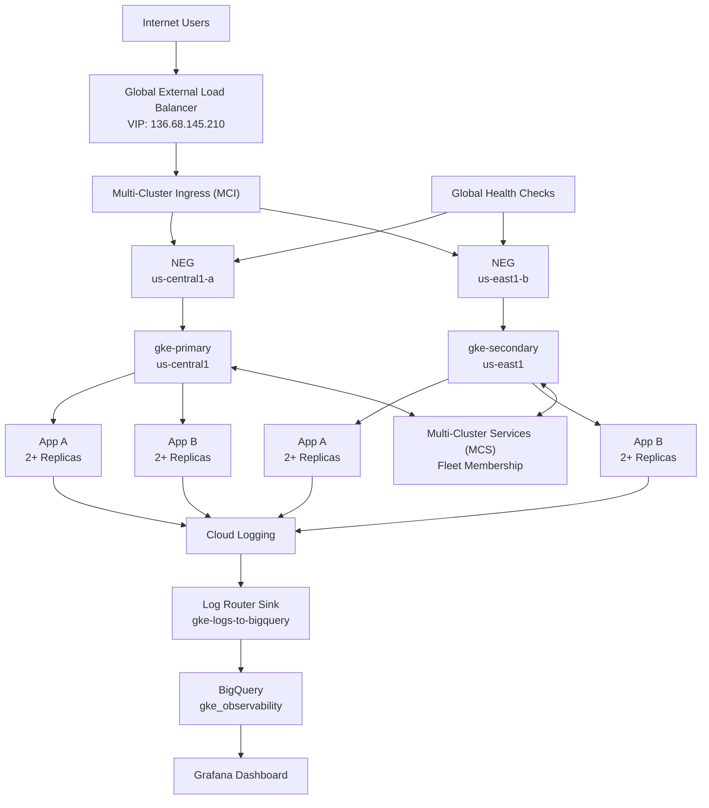

# GKE SRE Assessment Architecture

## Legend

The production traffic path is implemented using Google Kubernetes Engine Multi-Cluster Services (MCS) and Multi-Cluster Ingress (MCI). A Global External Load Balancer exposes a single public VIP (136.68.145.210) and distributes traffic across healthy backend services deployed in both gke-primary (us-central1) and gke-secondary (us-east1).

Multi-Cluster Ingress automatically provisions regional Network Endpoint Groups (NEGs), backend services, forwarding rules, URL maps, target proxies, and health checks. Traffic is routed only to healthy backends, providing automatic cross-regional failover and high availability.

Application telemetry from both clusters is centralized through Cloud Logging, exported via the gke-logs-to-bigquery Log Router sink, stored in the gke_observability BigQuery dataset, and visualized through Grafana dashboards.

Evidence of implementation includes:
- Multi-Cluster Services ACTIVE
- Multi-Cluster Ingress ACTIVE
- Fleet memberships registered for both clusters
- ServiceExport and ServiceImport resources created
- Global VIP: 136.68.145.210
- Network Endpoint Groups provisioned in us-central1-a and us-east1-b
- Health-check-based global traffic routing
